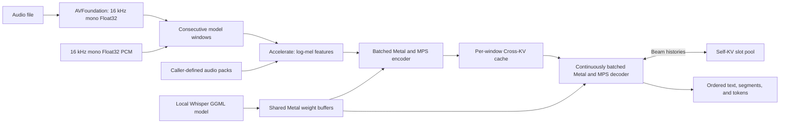

# Architecture

MetalWhisperM5 uses Swift for model loading, audio preparation, and scheduling. AVFoundation decodes audio, Accelerate computes log-mel features, and Metal and Metal Performance Shaders execute the neural network. The public Swift library and `metal-whisper` CLI share the same engine.

The file and PCM APIs divide the input into consecutive model windows, normally 30 seconds. The engine can prepare log-mel features ahead of inference. It returns results in source order and shifts segment and token times by each window's starting sample. Decoding a caller-supplied `MetalWhisperPackInput` uses its own prompt and returns pack-relative timestamps.

## Native GGML loading and log-mel features

The GGML loader uses a memory-mapped view when available and indexes tensor slices before preparing Metal weight buffers. It supports F32, F16, Q5_0, and Q8_0 tensor encodings. The loader expands weights into the formats needed by the chosen pipelines and can keep the Q5_0 output head in packed form for the tensor path. The vocabulary and mel filter bank come from the same model, with UTF-8 reconstructed after token bytes are assembled.

The audio path converts to mono Float32 at 16 kHz. Accelerate computes the windowed Fourier transform, applies the model's mel filter bank, and normalizes the log-mel features. Mel extraction workers prepare a bounded number of windows while the GPU processes the active batch.

## GPU selection and precision

`MetalWhisperConfiguration` allows explicit backend and Cross-KV choices. Builds with the macOS 26 SDK or newer can select the Apple10 optimizations. In automatic mode, the engine tests macOS availability and `supportsFamily(.apple10)`. The cooperative encoder additionally requires a 1,500-frame audio context and 64-dimensional heads. The engine JIT-compiles the Metal shader source and creates the pipeline states before selecting the optimized path. When the optimized encoder or Cross-KV pipelines are unavailable, the engine uses the portable MPS encoder with F16 Cross-KV. When the requested tensor decoder head is unavailable, the engine uses the MPS decoder.

The baseline encoder uses MPS matrix multiplications and a portable tiled FlashAttention kernel. Metal 4 cooperative FlashAttention uses tensor operations for full query tiles. The last query tile uses the higher-precision accumulation kernel. A register-tiled attention kernel also has its own precision tests. When the selected Metal 4 decoder pipeline is available with Q5_0 head weights, automatic mode can use MPS with a tensor output head for inputs of at most 120 seconds.

Layer normalization moments, softmax, and logits use FP32. GELU evaluates its erf formulation with a table and local polynomial and is checked against `libm`. The Metal compiler uses `mathMode = .safe` on macOS 15 and later and disables fast math on macOS 14. The portable shaders target Metal 3.1 on macOS 14 and Metal 3.2 on macOS 15 and later.

## Cross-attention KV

An encoder window has one Cross-KV slot shared by its decoder beams. The packed Q8 path quantizes non-rotated keys and values with independent scales per frame and head. The cross-attention kernel reads packed values, applies their scales, and runs the softmax with FP32 arithmetic. The engine can reuse slots for later windows and preserve an active slot for decoding retries, including temperature fallback. F16 Cross-KV stores half-precision values and uses the portable fused attention kernel.

## Continuous batching and memory

The engine admits new windows when a Cross-KV slot becomes available. The decoder groups active beams across windows and uses shared prefixes in the self-attention beam tree. The Self-KV slot pool recycles token rows as beams finish or retry. Both caches allocate against active capacity, and the Self-KV allocation can grow to preserve slot identities while copying cached rows. Result delivery follows input order.

Automatic batch sizing uses `MTLDevice.recommendedMaxWorkingSetSize`. The table shows limits before the model-specific GPU buffer cap. An explicit `maxBatchPacks` can constrain concurrent windows.

| Recommended working set | Automatic in-flight limit |
| --- | ---: |
| Below 16 GiB | 4 |
| 16 to below 24 GiB | 6 |
| 24 to below 32 GiB | 8 |
| 32 to below 40 GiB | 12 |
| 40 to below 48 GiB | 16 |
| 48 GiB and above | 24 |

Shared storage holds model weights and data that the CPU writes or reads. GPU-private buffers hold most intermediate activations and the KV caches. The engine reuses buffers across transcriptions and serializes access to its mutable workspace when a caller shares an engine.

## MPS decode-ahead

During MPS decoding, the CPU may encode the next command buffer while the GPU works on the current one. The preparation binds the existing buffers. The engine updates the shared token and KV metadata after beam selection, before submission. If the next step has matching decoder row and cross-group counts, the GPU can run the prepared commands. When the shape changes, the engine encodes a new command buffer.

Set `prepareDecoderAhead` to control this optimization. The optional `MetalWhisperProfileReport` includes decode-ahead preparation and reuse counts, GPU timings, CPU command encoding and wait timings, and Self-KV high-water marks. CPU and GPU phases can overlap.

[Numerical regression tests](../Tests/MetalWhisperM5Tests) · [Benchmark reproduction and measurement details](../Benchmarks/README.md).
